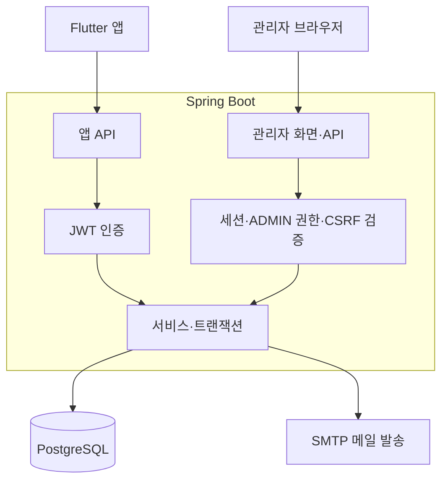
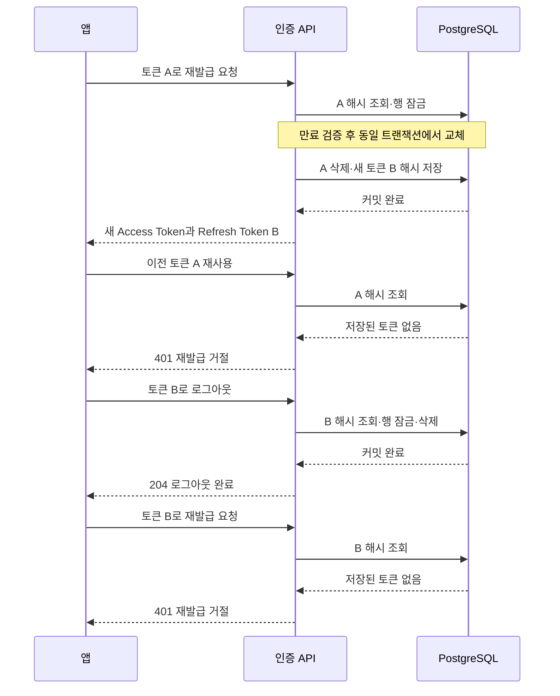

# 🍚 집밥PICK Backend

> 고민은 짧게, 집밥은 맛있게.

오늘 먹을 메뉴를 고르고 레시피를 확인하는 **집밥PICK**의 백엔드입니다. <Br>
Flutter 앱에 메뉴 추천·회원 인증·즐겨찾기 API를 제공하고, Thymeleaf 관리자 화면에서 메뉴와 공통코드를 관리합니다.

**토큰 재사용 차단 · 회원별 데이터 접근 제어 · 반복 요청의 중복 저장 방지**를 중심으로 구현했습니다.<Br>
주요 동작은 자동 테스트로 확인하고, PostgreSQL 쿼리는 실제 DB 환경에서 별도로 검증합니다.

[Flutter 앱](https://github.com/WONDongin/zipbob_app) · [ERD](https://www.erdcloud.com/d/3aFinoeCdppLGQ8Na) · [테스트 코드](src/test/java/com/zipbob/zipbob_backend) · [CI 실행 결과](https://github.com/hyeseon1020/zipbob_back/actions/workflows/backend-ci.yml)

[핵심 기능](#핵심-기능) · [서비스 구조](#서비스-구조) · [주요 설계](#주요-설계) · [테스트와 CI](#테스트와-ci) · [기술 스택](#기술-스택) · [로컬 실행](#로컬-실행)

<Br>

## 📌 핵심 기능

### 앱 서비스
- **비회원:** 메뉴 탐색·추천 이용
- **로그인 회원:** 즐겨찾기·최근 기록 등 개인 기능 이용
- **노출 정책:** 비활성 카테고리 메뉴는 앱 목록·상세·즐겨찾기·최근 기록 조회에서 제외

| 기능 | 구현 내용 |
| --- | --- |
| 메뉴 검색 | 메뉴명 검색과 카테고리 필터, 대표 이미지 조회 |
| 조건 추천 | 카테고리와 음식 특징을 조합해 추천 후보 조회 |
| 레시피 상세 | 재료·조리 순서·인분·조리 시간·난이도·이미지 제공 |
| 즐겨찾기 | 로그인한 회원별 등록·해제·목록 조회, 같은 메뉴 중복 저장 방지 |
| 최근 본 레시피 | 재조회 시 순서 갱신, 회원별 최신 5개 유지 |
| 회원가입·계정 관리 | 이메일 인증 후 회원가입, 내 정보 조회·닉네임 수정, 아이디 찾기·비밀번호 재설정 |
| 로그인 유지·로그아웃 | JWT 인증, Refresh Token 재발급·교체, 로그아웃한 토큰의 재사용 차단 |


<Br>

### 관리자 웹
관리자 목록에서는 비활성 카테고리에 속한 메뉴도 조회할 수 있어, 앱 노출 여부와 콘텐츠 관리를 구분했습니다.

| 기능 | 구현 내용 |
| --- | --- |
| 운영 대시보드 | 메뉴·회원 현황, 최근 7일 가입 추이, 카테고리·음식 특징별 메뉴 수, 즐겨찾기 인기 메뉴 |
| 메뉴 관리 | 메뉴 검색·카테고리 필터·페이지네이션, 레시피 등록·수정, 음식 특징 연결 관리 |
| 이미지 관리 | JPG·PNG 업로드 검증, PNG 변환 및 외부 디렉터리 저장 |
| 공통코드 관리 | 카테고리·음식 특징 등록·수정, 활성·비활성 상태 관리 |
| 회원 조회 | 아이디·닉네임·이메일 검색과 페이지네이션 |
| 관리자 인증 | 세션 로그인, ADMIN 권한 검사, 변경 요청 CSRF 보호 |

<Br>

## 📌 서비스 구조

앱 API와 관리자 웹은 같은 Spring Boot 서버에서 동작하며, 요청 경로에 따라 서로 다른 인증 설정을 적용합니다.<Br>
공개 메뉴 조회와 로그인·재발급 등은 별도 접근 정책을 적용합니다. 위 도식은 인증이 필요한 요청의 처리 구조입니다.


<Br>

## 📌 주요 설계

### 1. Refresh Token 교체와 재사용 차단

클라이언트에서 토큰을 지우는 것만으로는 서버에 남은 Refresh Token의 사용을 막을 수 없습니다. <Br>
**서버에서 토큰의 유효 상태를 관리**하도록 구현했습니다.

- **저장:** 토큰 원문 대신 SHA-256 해시를 DB에 저장합니다.
- **재발급:** 대상 행을 잠근 뒤 기존 토큰 삭제와 새 토큰 발급을 하나의 트랜잭션으로 처리합니다.
- **로그아웃:** 해당 Refresh Token을 삭제합니다.
- **재사용 차단:** 교체되거나 로그아웃한 토큰의 재발급 요청은 `401`로 거절합니다.

아래는 정상 발급된 토큰 A를 B로 교체한 뒤, 로그아웃하는 흐름입니다.



서비스·DB 테스트 **7개**, HTTP API 테스트 **4개**로 교체·재사용·만료·반복 로그아웃·입력 오류를 검증했습니다.

> 이미 발급된 Access Token은 별도의 즉시 폐기 정책 없이 만료까지 유효합니다.

[토큰 재발급·로그아웃 코드](src/main/java/com/zipbob/zipbob_backend/service/RefreshTokenService.java)

<Br>

### 2. 앱과 관리자의 인증 분리

앱은 요청마다 JWT를 보내고, 관리자 웹은 브라우저 세션을 사용합니다. <br>
인증 방식이 서로 영향을 주지 않도록 **SecurityFilterChain을 분리**했습니다.

| 구분 | 앱 API | 관리자 웹·API |
| --- | --- | --- |
| 인증 방식 | Bearer JWT | 폼 로그인·세션 |
| 세션 사용 | Stateless, 관리자 세션 사용 안 함 | 로그인 세션 사용 |
| 접근 제어 | JWT로 회원 확인 | ADMIN 권한 검사 |
| 변경 요청 보호 | Authorization 헤더 기반 인증 | CSRF 토큰 검증 |

보안 테스트에서는 다음 요청이 차단되는지 확인합니다.

- 일반 회원의 관리자 기능 접근
- CSRF 토큰 없는 관리자 변경 요청
- 관리자 세션만으로 앱 API에 접근하는 요청

[앱 보안 설정](src/main/java/com/zipbob/zipbob_backend/config/SecurityConfig.java) · [관리자 보안 설정](src/main/java/com/zipbob/zipbob_backend/admin/config/AdminSecurityConfig.java) · [보안 테스트](src/test/java/com/zipbob/zipbob_backend/security)

<Br>

### 3. 회원 기록의 중복 방지와 정합성

즐겨찾기 저장 전에 존재 여부만 조회하면, 동시에 들어온 두 요청이 모두 저장을 시도할 수 있습니다. <br>
**DB 제약조건과 트랜잭션으로 기록을 관리**했습니다.

| 대상 | 처리 방식 |
| --- | --- |
| 기록 소유자 | 클라이언트가 전달한 ID 대신 JWT로 확인한 회원 ID 사용 |
| 즐겨찾기 | 회원·메뉴 복합키와 `ON CONFLICT DO NOTHING`으로 중복 저장 방지 |
| 최근 기록 | 회원 행 잠금 후 저장·조회 시각 갱신·초과 기록 삭제를 한 트랜잭션에서 처리 |
| 조회 순서 | 조회 시각과 기록 ID를 기준으로 정렬해 최신 5개 유지 |

같은 회원의 요청은 잠금을 기다릴 수 있습니다. 서로 다른 회원의 요청은 같은 회원 행 잠금을 공유하지 않습니다.

즐겨찾기는 실제 PostgreSQL 테스트로 **중복 등록 방지와 회원별 조회·삭제 범위**를 검증합니다. <Br>
최근 기록과 토큰 재발급의 동시 요청 검증은 추가할 항목입니다.

[즐겨찾기 쿼리](src/main/java/com/zipbob/zipbob_backend/repository/LikeRepository.java) · [최근 기록 처리](src/main/java/com/zipbob/zipbob_backend/service/RecentRecipeService.java) · [PostgreSQL 테스트](src/integrationTest/java/com/zipbob/zipbob_backend/repository/LikeRepositoryIntegrationTest.java)

<Br>

### 4. 이메일 인증 증명의 목적·사용 상태 검증

회원가입에 사용한 인증 결과가 비밀번호 재설정 등 다른 작업에 재사용되지 않도록, <Br>
**인증번호 확인과 실제 작업 승인**을 나눴습니다.

1. 인증번호 확인에 성공하면 별도의 인증 증명을 발급합니다.
2. 후속 요청에서 이메일·인증 목적·만료·사용 여부를 검증합니다.
3. 실제 작업과 인증 증명 사용 처리를 같은 트랜잭션에서 수행합니다.

비밀번호 재설정은 **인증 증명 사용 → 비밀번호 변경 → 기존 Refresh Token 삭제**를 함께 처리합니다. <Br>회원 정보 불일치 등으로 작업이 실패하면 인증 증명의 사용 처리도 롤백됩니다.

[이메일 인증 코드](src/main/java/com/zipbob/zipbob_backend/service/EmailVerificationService.java) · [비밀번호 재설정 코드](src/main/java/com/zipbob/zipbob_backend/service/UserService.java)

<Br>

## 📌 테스트와 CI

- **서비스 로직:** 단위 테스트
- **인증·HTTP 응답:** MockMvc
- **PostgreSQL 전용 SQL:** 실제 PostgreSQL 통합 테스트

### 검증 항목

| 대상 | 주요 검증 항목 |
| --- | --- |
| JWT·앱 API | 서명·만료, 토큰 누락·오류, 삭제된 회원, 보호 경로 접근 |
| 관리자 보안 | 역할별 접근, CSRF, 앱 JWT와 관리자 세션 분리 |
| Refresh Token | 해시 저장, 재발급·교체, 로그아웃 후 재사용 차단 |
| 즐겨찾기 | 회원·메뉴 검증, 중복 등록 방지, 회원별 데이터 격리 |
| 대시보드 | 한국 시간 기준 최근 7일, 누락 날짜 보정, 합계·그래프 계산 |

**확인된 결과:** Refresh Token 테스트 11개 및 전체 기본 테스트 로컬 통과.<Br>
**추가 검증:** 이메일 인증·비밀번호 재설정의 실패·재사용 시나리오, 동시 요청

<Br>

### GitHub Actions

GitHub Actions는 PR과 `main`·`dev` push 시 다음 순서로 실행됩니다.

1. Java 21에서 기본 테스트와 빌드
2. PostgreSQL 18 테스트 DB 및 스키마 준비
3. PostgreSQL 통합 테스트 실행
4. 성공·실패 여부와 관계없이 테스트 리포트 보관

[CI 설정](.github/workflows/backend-ci.yml) · [최신 실행 결과](https://github.com/hyeseon1020/zipbob_back/actions/workflows/backend-ci.yml)

<Br>

## 📌 기술 스택

| 구분 | 기술 |
| --- | --- |
| 서버 | Java 21 · Spring Boot 4.1.1 |
| 데이터 | PostgreSQL · Spring Data JPA · JPQL · Native SQL · JdbcTemplate |
| 인증·관리자 화면 | Spring Security · JWT · BCrypt · Thymeleaf |
| 테스트·빌드 | JUnit 5 · Mockito · MockMvc · H2 · Gradle · GitHub Actions |

<Br>

## 📌 로컬 실행

JDK 21과 PostgreSQL이 필요합니다. `zipbob_app` 스키마·테이블·함수를 준비하고, <Br>
[설정 예시](src/main/resources/application.properties.example)를 참고해 `application.properties`에 DB·JWT·SMTP 설정을 추가합니다.

```powershell
.\gradlew.bat bootRun          # 서버 실행
.\gradlew.bat test             # 기본 테스트
.\gradlew.bat integrationTest  # PostgreSQL 통합 테스트
```

macOS·Linux에서는 `./gradlew`를 사용합니다.

PostgreSQL 통합 테스트는 아래 준비가 필요합니다.

1. [스키마 SQL](src/integrationTest/resources/db/schema.sql)을 테스트 전용 DB에 적용
2. `INTEGRATION_DB_URL`, `INTEGRATION_DB_USERNAME`, `INTEGRATION_DB_PASSWORD` 설정
3. `integrationTest` 실행

<details>
<summary>추가 설정</summary>

- JWT: `jwt.secret`(32바이트 난수의 Base64 값), `jwt.issuer`, `jwt.access-token-expiration-seconds`, `jwt.refresh-token-expiration-days`
- SMTP: 메일 서버 주소·포트·계정과 제공자에 맞는 TLS 설정
- 이미지: `app.menu-image-dir`(기본 `./images/menus`), multipart 파일·요청 용량 제한
- 관리자: `/admin/login`, 최초 계정 생성은 `admin.bootstrap.enabled` 및 `admin.bootstrap.id`·`admin.bootstrap.password`·`admin.bootstrap.name` 설정 사용

</details>